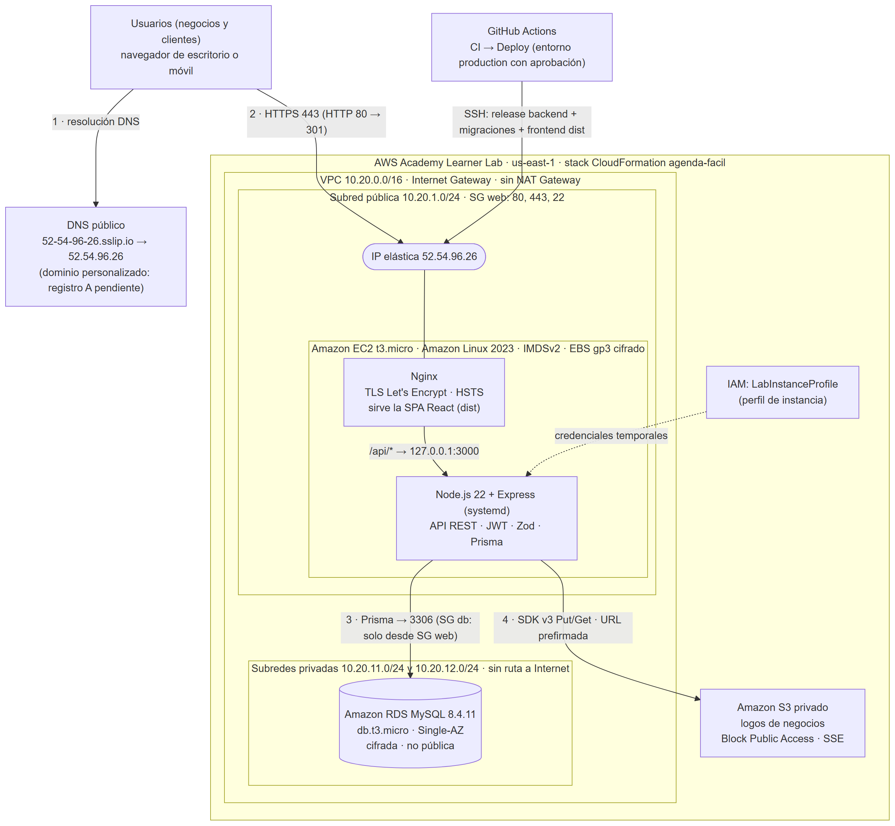

# Arquitectura e infraestructura AWS — modelo desplegado y su justificación

> Criterio 9 de la rúbrica. Estado: **desplegado** en AWS Academy Learner Lab (us-east-1, stack CloudFormation
> `agenda-facil`, `CREATE_COMPLETE`) y verificado el 2026-11-28 con la CLI de AWS y pruebas contra la URL pública.
> Detalle y salidas de comandos: [`docs/evidencias/despliegue-aws.md`](../docs/evidencias/despliegue-aws.md).

## 1. De la propuesta al modelo implementado

| Propuesta inicial (octubre 2026) | Implementado | Motivo del cambio |
|---|---|---|
| EC2 para el backend | **EC2 t3.micro** con Nginx + Node.js 22 | Igual |
| RDS relacional | **RDS MySQL 8.4.11** db.t3.micro, Single-AZ, privada | 8.4 LTS: la 8.0 salió de soporte estándar y cobraría *Extended Support* |
| S3 para archivos | **S3 privado** para logos (URLs prefirmadas) | El frontend lo sirve Nginx (ver CloudFront) |
| CloudFront (CDN) | **No desplegado** | El Learner Lab **deniega todas las acciones de CloudFront** (`AccessDenied`, ver `docs/evidencias/verificacion-servicios.txt`). La plantilla lo conserva con `EnableCloudFront=true` |
| Route 53 | **No desplegado** | No hay dominio propio; el nombre público lo resuelve el DNS gratuito `sslip.io` |
| IAM de mínimo privilegio | **`LabInstanceProfile`** | Learner Lab no permite crear roles; políticas objetivo en `infra/aws/iam/` |
| — | **VPC propia, IP elástica, Let's Encrypt, CloudFormation** | Red aislada, dirección fija, HTTPS sin CloudFront e infraestructura como código |

## 2. Componentes y su función

| Componente | Configuración real | Para qué sirve en Agenda Fácil |
|---|---|---|
| **AWS CloudFormation** | Plantilla `infra/aws/cloudformation/agenda-facil.yaml`, parámetro `EnableCloudFront=false` | Crea toda la infraestructura de forma reproducible (22 recursos) |
| **VPC** `10.20.0.0/16` | 2 subredes públicas (`10.20.1.0/24`, `10.20.2.0/24`) con ruta al **Internet Gateway**; 2 privadas (`10.20.11.0/24`, `10.20.12.0/24`) **sin ruta a Internet**; **sin NAT Gateway** | Aísla la aplicación; la base de datos no puede salir ni entrar desde Internet |
| **Amazon EC2** `agenda-facil-api` | t3.micro, Amazon Linux 2023, IMDSv2 obligatorio, EBS gp3 16 GB cifrado, perfil `LabInstanceProfile` | Servidor de la aplicación |
| **IP elástica** | `52.54.96.26` | Dirección pública fija: la URL no cambia aunque la instancia se detenga al cerrar el laboratorio |
| **Nginx** (en EC2) | TLS de Let's Encrypt (vence 2027-02-25, renovación automática), HTTP→HTTPS, HSTS, `server_tokens off` | Puerta de entrada: sirve el frontend React compilado y reenvía `/api/*` a Node.js |
| **Node.js 22 + Express** (systemd `agenda-facil-api`) | Usuario de sistema `agenda` sin shell, releases en `/opt/agenda-facil/releases` | API REST: autenticación JWT, roles, validación Zod, reglas de reservas |
| **Prisma** | `prisma migrate deploy` en cada despliegue | Acceso tipado a MySQL y migraciones versionadas |
| **Amazon RDS MySQL** `agenda-facil-db` | 8.4.11, db.t3.micro, Single-AZ, 20 GB gp2 cifrados, `PubliclyAccessible: false`, copias 1 día | Datos: usuarios, negocios, servicios, horarios, clientes, reservas |
| **Amazon S3** `agenda-facil-uploads-<cuenta>` | Block Public Access (4/4), SSE-AES256, versionado, política que niega HTTP sin TLS | Logos de los negocios |
| **Security groups** | *web-sg*: 80 y 443 desde Internet, 22 (solo llave). *db-sg*: 3306 **solo desde web-sg** | Cortafuegos por instancia |
| **IAM** | `LabInstanceProfile` asociado a EC2 | La API obtiene credenciales temporales (IMDSv2) para S3 sin guardar claves |

## 3. Recorrido de una petición

1. El navegador resuelve `52-54-96-26.sslip.io` → `52.54.96.26` (IP elástica).
2. Conecta por **HTTPS 443** al security group *web-sg* → **Nginx** (si llega por HTTP 80, responde 301 a HTTPS).
3. Si la ruta es de la interfaz (`/`, `/panel/citas`…), Nginx entrega `index.html` y los `assets/` de React
   (`try_files $uri /index.html`).
4. Si la ruta empieza por `/api/`, Nginx la reenvía a `http://127.0.0.1:3000` (Node.js) con `X-Forwarded-For`/`-Proto`.
5. Express valida el token JWT y el rol, valida los datos con Zod y usa **Prisma** para consultar **RDS** por el puerto
   3306 dentro de la VPC (permitido solo porque el origen es *web-sg*).
6. La respuesta JSON vuelve por el mismo camino, cifrada con TLS.

## 4. Conexión con MySQL

- Cadena `DATABASE_URL` en `/etc/agenda-facil/api.env` (permisos 600, propietario `agenda`), escrita por el workflow
  desde el secreto `PROD_DATABASE_URL`; nunca está en el repositorio.
- Usuario de aplicación **`agenda_app`** con permisos solo sobre la base `agenda_facil`
  (`SELECT, INSERT, UPDATE, DELETE, CREATE, ALTER, INDEX, DROP, REFERENCES`), distinto del administrador `agenda_admin`.
- El tráfico API → RDS circula solo por la red privada de la VPC. RDS tiene `require_secure_transport = OFF` (valor
  por defecto, verificado): forzar TLS (*parameter group* con `ON` y `sslaccept=strict` con el certificado de RDS) queda
  como mejora documentada en la auditoría.
- La doble reserva se evita con una transacción y un bloqueo por negocio **en MySQL** (válido aunque hubiera varias instancias).

## 5. Almacenamiento de archivos

`POST /api/business/logo` → la API valida tipo (PNG/JPG/WEBP por firma binaria) y tamaño (2 MB) → `PutObject` en S3 con
cifrado → la API devuelve una **URL prefirmada** de 1 hora. Verificado en producción: con firma 200 `image/png`; sin
firma 403.

## 6. Protección de la infraestructura

| Capa | Medida |
|---|---|
| Red | RDS en subredes privadas sin ruta a Internet; SG de base de datos solo desde el SG web |
| Transporte | HTTPS con Let's Encrypt, HSTS, redirección 301, S3 rechaza HTTP |
| Servidor | IMDSv2, SSH solo con llave, proceso sin privilegios, `NoNewPrivileges`, `ProtectSystem`, versión de Nginx oculta |
| Datos | EBS, RDS y S3 cifrados; S3 privado; contraseñas con bcrypt |
| Aplicación | JWT, roles, Zod, Helmet, CORS restringido al dominio, *rate limiting* en autenticación, límite de 100 KB por petición |
| Secretos | Solo en secretos del entorno `production` de GitHub y en `api.env` del servidor |
| Despliegue | Solo commits de `main`, aprobación manual, rollback automático |

## 7. Cómo se despliega

1. `bash infra/aws/scripts/00-verificar-servicios.sh` (detectó CloudFront bloqueado).
2. `ENABLE_CLOUDFRONT=false bash infra/aws/scripts/01-desplegar-infraestructura.sh` (CloudFormation, ~10 min por RDS).
3. User data de EC2 (`bootstrap-ec2.sh`): Node 22 verificado por SHA-256, Nginx, servicio systemd.
4. Usuario de aplicación en RDS desde EC2 (`crear-usuario-app.sql`).
5. `sudo bash configurar-https.sh 52-54-96-26.sslip.io` (certificado y renovación).
6. GitHub Actions (`deploy.yml`) publica backend y frontend tras la aprobación (ver `EXPLICACION_CICD.md`).

## 8. Qué mostrar en la consola de AWS Academy

| Consola | Qué enseñar |
|---|---|
| CloudFormation → `agenda-facil` | `CREATE_COMPLETE`, pestañas *Resources*, *Outputs* (`ApiPublicIp`, `Ec2PublicHostname`) y *Parameters* (`EnableCloudFront=false`) |
| EC2 → Instances → `agenda-facil-api` | *Running*, t3.micro, IP elástica, IMDSv2 *Required*, perfil `LabInstanceProfile` |
| EC2 → Security Groups | Reglas de *web-sg* (80/443/22) y *db-sg* (3306 desde *web-sg*) |
| VPC → Subnets / Route tables | Públicas con `0.0.0.0/0 → igw`, privadas sin esa ruta; NAT Gateways: 0 |
| RDS → `agenda-facil-db` | *Available*, MySQL 8.4.11, *Publicly accessible: No*, *Encryption: Enabled*, Single-AZ |
| S3 → `agenda-facil-uploads-…` | *Block all public access: On*, cifrado, objetos `logos/…` |

## 9. Costos y presupuesto

Estimación con precios bajo demanda de us-east-1: **≈ USD 0,037/h con todo encendido (≈ USD 0,90/día)**; con EC2 y RDS
detenidas ≈ USD 0,24/día (almacenamiento e IP). Consumo mostrado por el Learner Lab durante el despliegue: USD 0,8 de 50
(el contador se actualiza con retraso). La propuesta estimaba USD 43,26/mes con CloudFront y Route 53, que no se usan.

## 10. Escalabilidad

La API no guarda estado de sesión (JWT): puede ejecutarse en varias instancias detrás de un Application Load Balancer
con Auto Scaling. RDS puede crecer verticalmente, activar Multi-AZ y réplicas de lectura. Con una cuenta que permita
CloudFront, `EnableCloudFront=true` mueve el frontend a S3 + CDN sin cambiar el código.
