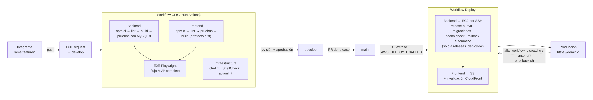

# CI/CD con GitHub Actions — explicación para la sustentación

**CI (integración continua):** cada cambio se verifica automáticamente (instalar, analizar, probar, construir) antes
de integrarse. **CD (entrega/despliegue continuo):** cuando `main` está verde, el sistema se publica de forma
automática y repetible, con capacidad de volver atrás.

## Flujo de trabajo del equipo
1. El integrante trabaja en `feature/<area>` y hace commits con formato `tipo(area): descripción`.
2. Abre un **Pull Request** hacia `develop` → se ejecuta **CI** → otro integrante revisa y aprueba → *merge*.
3. Para publicar una versión: PR `develop → main` → CI → *merge* → se dispara **Deploy**.

## Workflow `ci.yml` (Pull Requests y push a develop/main)
| Job | Qué hace | Por qué |
|---|---|---|
| Backend | `npm ci` → lint → build (Prisma) → 50 pruebas contra un **contenedor MySQL 8** | Las reglas críticas (doble reserva, aislamiento) se prueban con una BD real |
| Frontend | `npm ci` → lint → 10 pruebas → `vite build` → guarda `dist` como artefacto | Garantiza que la interfaz compila y sus validaciones funcionan |
| Infraestructura | cfn-lint (plantilla), ShellCheck (scripts), actionlint (workflows), plantilla sincronizada | Los errores de infraestructura se detectan antes de llegar a AWS |
| E2E | Levanta API + frontend, instala Chromium y recorre el flujo MVP (18 pasos); guarda capturas | Verifica el sistema completo como lo usaría una persona |

Configuración relevante: `concurrency` (cancela ejecuciones viejas de la misma rama), `permissions: contents: read`
(mínimo privilegio del token), caché de npm.

## Workflow `deploy.yml`
- **Disparo**: cuando CI termina **con éxito en `main`**, o manualmente con un `ref` (commit/tag) para hacer rollback.
- **Protección**: solo corre si la variable `AWS_DEPLOY_ENABLED` es `true`; `concurrency` impide dos despliegues a la vez; usa el entorno `production`.
- **Backend → EC2**: empaqueta el backend, escribe `/etc/agenda-facil/api.env` desde **GitHub Secrets** (por stdin, nunca en el repositorio ni en los logs) y ejecuta `remote-deploy.sh`: crea una *release* nueva, instala dependencias, genera Prisma, aplica migraciones, activa la release (enlace `current`), reinicia el servicio y verifica `/api/health`. Si falla, **vuelve sola** a la release anterior.
- **Frontend → S3 + CloudFront**: compila, sincroniza `dist` en S3 (assets con caché larga e `index.html` sin caché) e invalida la caché de CloudFront.

## Rollback (3 niveles)
1. Automático en el servidor (health check fallido).
2. *Actions → Deploy → Run workflow* con el tag/commit estable anterior.
3. Manual: `sudo bash rollback.sh` en EC2 (solo releases marcadas como sanas).
Las migraciones no se revierten solas: se diseñan compatibles con la versión anterior.

## Secretos y variables
Secretos: `AWS_ACCESS_KEY_ID`, `AWS_SECRET_ACCESS_KEY`, `AWS_SESSION_TOKEN`, `EC2_HOST`, `EC2_SSH_KEY`,
`PROD_DATABASE_URL`, `PROD_JWT_SECRET`. Variables: `AWS_REGION`, `S3_FRONTEND_BUCKET`, `S3_UPLOADS_BUCKET`,
`CLOUDFRONT_DISTRIBUTION_ID`, `PUBLIC_ORIGIN`, `AWS_DEPLOY_ENABLED`. En Learner Lab las tres credenciales AWS caducan en cada sesión.

## Estado real
Workflows validados con **actionlint** (0 hallazgos) y comandos ejecutados con éxito en un clon limpio. **La primera
ejecución en GitHub ocurre al publicar el repositorio**; mostrar en la sustentación la pestaña *Actions* real.
