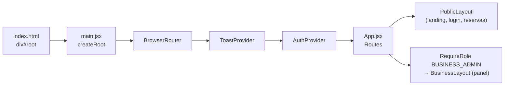

# Frontend React — explicación de componentes y configuración

> Criterio 8 de la rúbrica. Todo lo que se describe aquí se comprobó en el código de `frontend/`.

## 0. ¿Next.js o Vite? (`next.config`)

Agenda Fácil **no usa Next.js**: no existe `next.config.js`/`next.config.ts`, ni carpetas `app/` o `pages/` de Next, ni
renderizado en servidor. Es una **SPA (Single Page Application) de React 19 construida con Vite 6**. El archivo que cumple
el papel de `next.config` es **`frontend/vite.config.js`**:

```js
export default defineConfig({
  plugins: [react()],                       // JSX + Fast Refresh en desarrollo
  server: {
    port: 5173,
    proxy: { '/api': 'http://localhost:3000', '/uploads': 'http://localhost:3000' }, // backend local
  },
  build: { outDir: 'dist', sourcemap: false }, // salida estática que se publica en producción
  test: { environment: 'jsdom', setupFiles: ['./src/test/setup.js'], css: false },  // Vitest
});
```

| Pregunta de la rúbrica | Respuesta en Agenda Fácil |
|---|---|
| ¿Dónde está el componente principal? | `frontend/src/App.jsx` (define todas las rutas). Se monta desde `frontend/src/main.jsx` |
| ¿Cuál es el punto de entrada? | `frontend/index.html` (contiene `<div id="root">` y carga `/src/main.jsx`) → `main.jsx` → `App.jsx` |
| ¿Dónde está el HTML? | `frontend/index.html` (único HTML; React genera el resto en el navegador) |
| ¿Dónde está el CSS? | `frontend/src/styles/global.css` (sistema de diseño con variables CSS y *media queries*), importado en `main.jsx` |
| ¿Dónde está el JavaScript? | `frontend/src/**/*.jsx` y `*.js` (JavaScript moderno con JSX; no se usa TypeScript) |
| ¿Carpeta de estáticos? | `frontend/public/` (`favicon.svg`, se copia tal cual). La compilación genera `frontend/dist/` (`index.html` + `assets/*.js` y `*.css` con hash) |
| ¿Dónde están los componentes? | `frontend/src/components/` (reutilizables) y `frontend/src/pages/` (pantallas) |
| ¿Cómo se comunica con el backend? | `frontend/src/api/client.js` con `fetch` a rutas relativas `/api/...` (mismo dominio) |

## 1. Flujo de arranque



```jsx
// frontend/src/main.jsx
createRoot(document.getElementById('root')).render(
  <StrictMode>
    <BrowserRouter>
      <ToastProvider>
        <AuthProvider>
          <App />
        </AuthProvider>
      </ToastProvider>
    </BrowserRouter>
  </StrictMode>,
);
```

## 2. Estructura de carpetas (`frontend/`)

| Ruta | Función |
|---|---|
| `index.html` | HTML base, metadatos (idioma, descripción, `theme-color`) y punto de montaje |
| `vite.config.js` | Configuración de Vite (desarrollo, proxy, build, pruebas) |
| `eslint.config.js` | Reglas de calidad (React, hooks, refresh) — `npm run lint` |
| `package.json` | Dependencias (React 19, React Router 7, lucide-react) y scripts `dev`, `build`, `preview`, `lint`, `test` |
| `public/` | Archivos estáticos sin procesar (`favicon.svg`) |
| `src/main.jsx` | Punto de entrada: proveedores globales y estilos |
| `src/App.jsx` | **Componente principal**: mapa de rutas |
| `src/api/client.js` | Cliente HTTP: token JWT, errores normalizados (`ApiError`), cierre de sesión ante 401 |
| `src/context/AuthContext.jsx` | Estado de sesión: usuario, negocio, `login`, `register*`, `logout`, `refresh` |
| `src/context/ToastContext.jsx` | Notificaciones de éxito y error |
| `src/hooks/useAsync.js` | Carga de datos remotos con `loading`, `error`, `data`, `reload` |
| `src/components/ui.jsx` | Componentes reutilizables: `Button`, `Field`, `Input`, `Select`, `Textarea`, `Alert`, `Spinner`, `EmptyState`, `StatusBadge`, `Badge`, `Card`, `PageHeader`, `StatCard`, `Modal`, `ConfirmDialog` |
| `src/components/Layouts.jsx` | `PublicLayout`, `BusinessLayout` (barra lateral del panel) y **`RequireRole`** (control de acceso) |
| `src/components/SlotPicker.jsx` | Selector de fecha y franjas libres (cliente y negocio) |
| `src/components/AccountForms.jsx` | Formularios de cuenta compartidos |
| `src/pages/Landing.jsx` | **Primera vista**: landing page con problema, funcionalidades y planes (desde la API) |
| `src/pages/auth/` | `Login.jsx`, `Register.jsx` (negocio o cliente) |
| `src/pages/client/` | `Directory`, `BookingPage`, `MyReservations`, `Account` |
| `src/pages/business/` | `Dashboard`, `Reservations`, `ReservationForm`, `Services`, `Hours`, `Clients`, `ClientForm`, `ClientDetail`, `Settings` |
| `src/utils/` | `format.js` (fechas y dinero) y `validation.js` (validación en el cliente) |
| `src/styles/global.css` | Estilos globales y responsive (1024, 900, 720 y 340 px) |
| `src/__tests__/`, `src/test/setup.js` | 10 pruebas de componentes y utilidades (Vitest + Testing Library) |

## 3. Rutas y control de acceso (criterio 7)

```jsx
// frontend/src/App.jsx (resumen)
<Route element={<PublicLayout />}>
  <Route index element={<Landing />} />              {/* primera vista: landing page */}
  <Route path="ingresar" element={<Login />} />
  <Route path="registro" element={<Register />} />
  <Route path="reservar" element={<Directory />} />
  <Route path="reservar/:slug" element={<BookingPage />} />
  <Route element={<RequireRole role="CLIENT" />}>    {/* solo clientes autenticados */}
    <Route path="mis-reservas" element={<MyReservations />} />
    <Route path="cuenta" element={<Account />} />
  </Route>
</Route>
<Route element={<RequireRole role="BUSINESS_ADMIN" />}> {/* solo administradores de negocio */}
  <Route path="panel" element={<BusinessLayout />}> … </Route>
</Route>
```

```jsx
// frontend/src/components/Layouts.jsx
export function RequireRole({ role }) {
  …
  if (!user) return <Navigate to="/ingresar" replace state={{ from: location.pathname + location.search }} />;
  if (role && user.role !== role) return <Navigate to={homeForRole(user.role)} replace />;
  …
}
```

Verificado en producción: la primera vista es la landing (`docs/capturas/aws/prod-00-primera-vista-landing.png`) y
`/panel` sin sesión redirige al login (`prod-18-panel-sin-sesion-redirige-login.png`). La protección real está en el
backend: sin token la API responde **401** y con el rol equivocado **403** (`docs/evidencias/verificacion-produccion.txt`).

## 4. Comunicación con el backend

```js
// frontend/src/api/client.js
const BASE_URL = import.meta.env.VITE_API_URL || '';            // vacío → mismo dominio
const url = new URL(`${BASE_URL}/api${path}`, window.location.origin);
// Añade "Authorization: Bearer <token>", serializa JSON, y ante 401 cierra la sesión.
```

- **Desarrollo:** el navegador llama a `http://localhost:5173/api/...` y Vite lo redirige al backend en `:3000`.
- **Producción:** el navegador llama a `https://52-54-96-26.sslip.io/api/...` y **Nginx** lo envía a Node.js en
  `127.0.0.1:3000`. Frontend y API comparten dominio: no hay problemas de CORS ni de cookies de terceros.
- El token JWT se guarda en `localStorage` (`agenda-facil.token`); al recargar, `AuthContext` llama a `/api/auth/me`.

## 5. Build y publicación

```bash
npm ci --prefix frontend
npm run build --prefix frontend      # → frontend/dist (index.html + assets con hash)
```

En producción el job *Frontend* de `deploy.yml` empaqueta `frontend/dist` y `remote-frontend.sh` lo publica en
`/opt/agenda-facil/frontend` (cambio atómico por enlace simbólico). Nginx sirve los archivos con
`try_files $uri /index.html`, así que al recargar `/panel/citas` se entrega `index.html` y React Router resuelve la ruta.
`assets/` se cachea 1 año (nombres con hash) e `index.html` va con `no-cache`.

## 6. Estado, formularios y diseño responsive

- **Estado global:** sesión (`AuthContext`) y notificaciones (`ToastContext`). **Local:** `useState` y `useAsync`.
- **Validación doble:** inmediata en el cliente (`utils/validation.js`, con `aria-invalid` y `role="alert"`) y
  definitiva en el backend con Zod; los errores por campo del backend se muestran en el mismo formulario.
- **Responsive:** en móvil la barra lateral pasa a menú desplegable, las tablas a tarjetas y los modales a hoja inferior.
  El E2E comprueba que no haya desbordamiento horizontal en móvil, tablet y escritorio.

## 7. Guía rápida para entender el proyecto

1. Abre `frontend/index.html` → verás el `div#root`.
2. Sigue a `src/main.jsx` → proveedores globales.
3. Lee `src/App.jsx` → todas las pantallas y quién puede verlas.
4. Abre una página, p. ej. `src/pages/business/Services.jsx` → usa `useAsync` para cargar datos con `api/client.js` y
   componentes de `components/ui.jsx`.
5. Ejecuta `npm run dev --prefix frontend` con el backend encendido y navega a `http://localhost:5173`.
